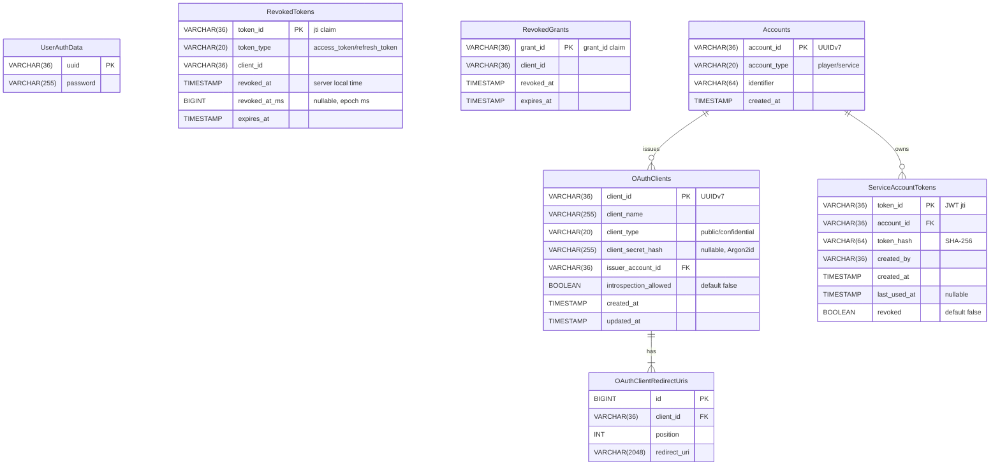

## UserAuthData

Table for managing user authentication information.

| Column Name | Type | Example | Description |
|-------------|------|---------|-------------|
| uuid | VARCHAR(36) PK | `550e8400-e29b-41d4-a716-446655440000` | Player's Minecraft UUID |
| password | VARCHAR(255) | `$argon2id$v=19$...` | Password hashed with Argon2id |

---

## RevokedTokens

Table `revoked_tokens` for managing revoked tokens and refresh tokens used up by rotation. A token whose `jti` claim matches a row is rejected.

| Column Name | Type | Example | Description |
|-------------|------|---------|-------------|
| token_id | VARCHAR(36) PK | `550e8400-...` | Token's JWT ID (`jti` claim) |
| token_type | VARCHAR(20) | `refresh_token` | Token type: "access_token" or "refresh_token" |
| client_id | VARCHAR(36) | `019234ab-...` | Client the token was issued to |
| revoked_at | TIMESTAMP | `2025-01-06 12:00:00` | Revocation timestamp in the server's local time, for operators reading the table |
| revoked_at_ms | BIGINT NULL | `1736132400000` | Revocation instant in milliseconds since the Unix epoch, used for the refresh token grace period (NULL for rows written before this column existed or by an earlier version) |
| expires_at | TIMESTAMP | `2025-02-05 12:00:00` | Token expiration time in the server's local time, used by the periodic cleanup |

Like the other timestamp columns on this page, `revoked_at` uses the local time of the server that wrote the row. MineAuth does not use it for any decision.

The refresh token grace period is measured from `revoked_at_ms` only, possibly by another server sharing the database. A timestamp column can be converted through the time zone of the JVM or of the database session when it is written and read, and a value that falls into a daylight saving time gap can be shifted by an hour. A number of milliseconds has no time zone, so it is not affected by either.

At startup, `DatabaseMigrator` adds `revoked_at_ms` to an existing `revoked_tokens` table. The database user must be allowed to alter the table. Existing rows keep NULL, and so do rows written later by an earlier version of MineAuth that shares the database. Presenting a refresh token whose row has no `revoked_at_ms` again is treated as reuse (see [Refresh Token Rotation](/docs/developer/oauth/refresh-token-rotation#implementation-notes)).

---

## RevokedGrants

Table for managing revoked grants. Every access token and refresh token whose `grant_id` claim matches a row is rejected.

| Column Name | Type | Example | Description |
|-------------|------|---------|-------------|
| grant_id | VARCHAR(36) PK | `550e8400-...` | Revoked grant ID (`grant_id` claim) |
| client_id | VARCHAR(36) | `019234ab-...` | Client the grant was issued to |
| revoked_at | TIMESTAMP | `2025-01-06 12:00:00` | Revocation timestamp |
| expires_at | TIMESTAMP | `2025-02-06 12:00:00` | Time after which the periodic cleanup can remove the row |

---

## Accounts

Table for managing account information. Supports both player accounts and service accounts (robot accounts).

| Column Name | Type | Example | Description |
|-------------|------|---------|-------------|
| account_id | VARCHAR(36) PK | `019234ab-...` | Account ID (UUIDv7, time-sortable) |
| account_type | VARCHAR(20) | `player` | Account type: "player" or "service" |
| identifier | VARCHAR(64) | `550e8400-e29b-41d4-a716-446655440000` | Minecraft UUID for players, service name for services |
| created_at | TIMESTAMP | `2025-01-06 12:00:00` | Account creation timestamp |

---

## OAuthClients

Table for managing OAuth2/OIDC client applications.

| Column Name | Type | Example | Description |
|-------------|------|---------|-------------|
| client_id | VARCHAR(36) PK | `019234ab-...` | Client ID (UUIDv7, time-sortable) |
| client_name | VARCHAR(255) | `My OAuth App` | Client display name |
| client_type | VARCHAR(20) | `confidential` | Client type: "public" or "confidential" |
| client_secret_hash | VARCHAR(255) NULL | `$argon2id$v=19$...` | Secret hashed with Argon2id (NULL for public clients) |
| issuer_account_id | VARCHAR(36) FK | `019234ab-...` | Issuer's account ID (references Accounts table) |
| introspection_allowed | BOOLEAN | `false` | Whether the client may use the token introspection endpoint |
| created_at | TIMESTAMP | `2025-01-06 12:00:00` | Client creation timestamp |
| updated_at | TIMESTAMP | `2025-01-06 12:00:00` | Client update timestamp |

---

Redirect URIs are stored in the OAuthClientRedirectUris table.

---

## OAuthClientRedirectUris

Table for managing redirect URIs of OAuth clients. A client can have several redirect URIs.

| Column Name | Type | Example | Description |
|-------------|------|---------|-------------|
| id | BIGINT PK | `1` | Auto-increment ID |
| client_id | VARCHAR(36) FK | `019234ab-...` | Client ID (references OAuthClients table, deleted together with the client) |
| position | INT | `0` | Registration order, starting from 0. Unique together with `client_id` |
| redirect_uri | VARCHAR(2048) | `https://example\.com/callback.*` | Redirect URI (supports regex patterns) |

### Migration from earlier versions

Earlier versions stored a single redirect URI in `oauth_clients.redirect_uri`.
At startup, `DatabaseMigrator` copies that value to `oauth_client_redirect_uris` (as `position = 0`) and then drops the old column with exposed-migration.
The migration checks the actual schema, so it runs only once and is safe to repeat.

:::warning[Upgrade every server at once]
If several servers share one database, upgrade all of them at the same time.
A server running an earlier version reads `oauth_clients.redirect_uri`, which no longer exists after the migration.
:::

---

## ServiceAccountTokens

Table for managing service account tokens. Stores metadata for JWT tokens issued to service accounts.

| Column Name | Type | Example | Description |
|-------------|------|---------|-------------|
| token_id | VARCHAR(36) PK | `019234ab-...` | Token's JWT ID (jti claim) |
| account_id | VARCHAR(36) FK | `019234ab-...` | Account ID (references Accounts table) |
| token_hash | VARCHAR(64) | `a1b2c3d4...` | SHA-256 hash of the token (for leak verification) |
| created_by | VARCHAR(36) | `550e8400-...` | Player UUID of the administrator who created the token |
| created_at | TIMESTAMP | `2025-01-06 12:00:00` | Token creation timestamp |
| last_used_at | TIMESTAMP NULL | `2025-01-07 09:30:00` | Last used timestamp (NULL if never used) |
| revoked | BOOLEAN | `false` | Whether the token has been revoked |

---

## ER Diagram

